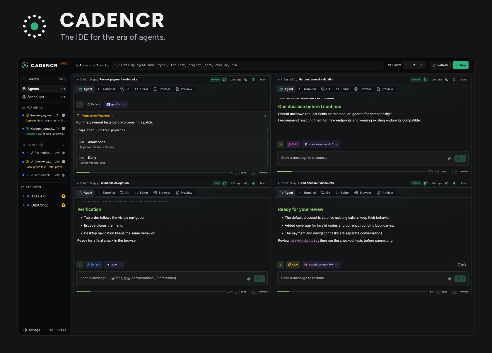
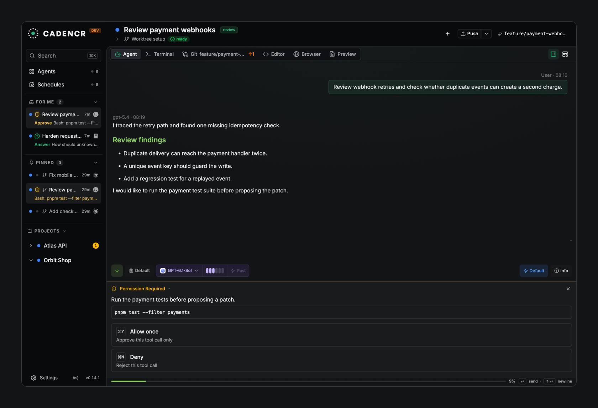
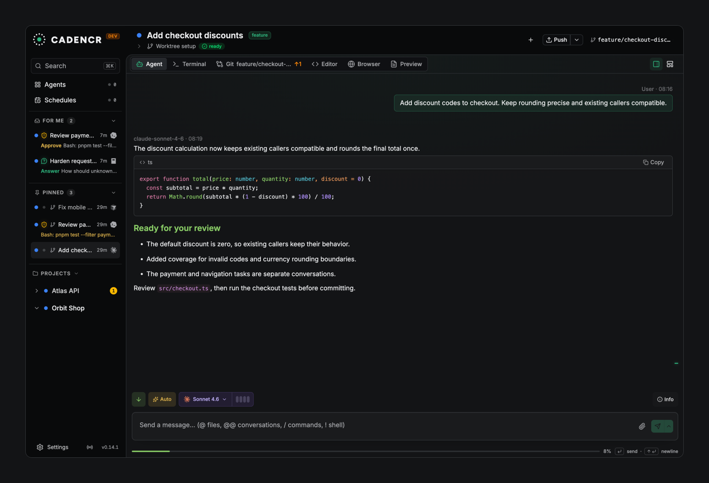

# CadencR

## Run agents. Stay in control. Ship.

The desktop workspace for managing AI coding agents. **Run Claude Code, Codex, Cursor, and OpenCode across projects. See their progress, handle their requests, and steer the work from one place.**

[**Download for macOS →**](https://github.com/merkr-software/CadencR/releases/latest) · [Website & demo](https://cadencr.com) · [Documentation](https://cadencr.com/docs/) · [What's new](https://cadencr.com/news/)

**Free & open source · Local-first · No telemetry · Apache 2.0**

[](./.github/assets/readme/hero.png)

_One view for your agents across projects. Captured in CadencR v0.14.1 with example conversations._

```bash
brew install --cask merkr-software/cadencr/cadencr
```

**Bring the agents you already use. Add your repositories. Start delegating.** CadencR keeps parallel conversations organized and brings your attention back when an agent needs a decision.

## More parallel work. A clearer next move.

Start a feature with Claude Code, investigate a bug with Codex, and keep another project moving with Cursor or OpenCode. Give independent tasks their own Git worktree and branch. See every conversation in a live agent grid, or focus on one workspace with split panes.

### Know which agent needs you next.

When an agent needs you, **For me** names the next action: answer a question, approve a command, inspect an error, fix CI, review a reply, or merge a ready proposal. Spend your attention on decisions while the other agents keep working.

[](./.github/assets/readme/attention.png)

_The next decision is explicit: what the agent wants to run, why, and whether you allow it. Example conversation._

- **Keep your bearings.** Pinned conversations, saved sidebar views, live status, and keyboard navigation keep work across projects within reach.
- **Make approvals legible.** Review plans, exact tool commands, and structured questions inside the conversation. Permission modes follow each provider's capabilities.
- **Keep the useful context.** Search conversations, inspect context usage, and rewind or fork with providers that support it.
- **Choose how files are shared.** Use a new worktree for independent edits, or deliberately reuse a checkout when conversations should share files. Worktrees isolate Git working copies; they are not permission sandboxes.

[Explore parallel work](https://cadencr.com/docs/unified-agent-list/) · [Worktrees](https://cadencr.com/docs/worktrees/) · [Approvals](https://cadencr.com/docs/approvals/)

## Steer the conversation. Keep the context.

Open an agent's conversation and pick up where you left off. Read rendered responses, grouped tool calls, and inline diffs. See its model and context usage, attach files, ask a follow-up, or change direction while it works.

[](./.github/assets/readme/review.png)

_A focused conversation, with the rest of your agents still within reach. Example project data._

- **Choose per task.** Use the provider, model, profile, and supported thinking or permission controls that fit the work.
- **Resume with your bearings intact.** Search earlier messages, jump between your prompts, and revisit the code or file references in context.
- **Explore another direction.** Supported providers can rewind to a pre-turn code checkpoint or fork a conversation that shares the current checkout.
- **Drive it from the keyboard.** Navigate conversations, switch panes, and handle agent checkpoints without reaching for the mouse.

[Conversation guide](https://cadencr.com/docs/session-view/) · [Providers & profiles](https://cadencr.com/docs/providers/) · [Keyboard shortcuts](https://cadencr.com/docs/shortcuts/)

## Let your agents coordinate, too.

CadencR's **Project and Workspace MCP** give agents tools to find earlier work, read related conversations, and spawn or message other sessions. An investigation can inform an implementation; a review can return to the agent that made the change.

| Workflow                      | What CadencR makes possible                                                                                                                           |
| ----------------------------- | ----------------------------------------------------------------------------------------------------------------------------------------------------- |
| **Delegate in parallel**      | Give independent work its own conversation and worktree, then bring the results back to the coordinating agent.                                       |
| **Reuse prior work**          | Search session history across projects and read the relevant conversation before starting again.                                                      |
| **Schedule a follow-up**      | Send a prompt once or on a recurring rule. Run a check first: success stays quiet; failure sends its output to the agent. The host must stay running. |
| **Steer from another device** | Pair a phone, tablet, or second computer over your LAN or Tailscale and return to the same sessions. Your Mac remains the host.                       |

[MCP & orchestration](https://cadencr.com/docs/mcp/) · [Schedules](https://cadencr.com/docs/schedules/) · [Remote access](https://cadencr.com/docs/remote-access/)

## The tools around the agent, already in place.

When you need to inspect, test, or ship what an agent produced, open the relevant pane beside the conversation.

| Surface               | What you can do                                                                                                                                                                                 |
| --------------------- | ----------------------------------------------------------------------------------------------------------------------------------------------------------------------------------------------- |
| **Editor**            | Edit with CodeMirror, LSP navigation, diagnostics, rename, search, splits, and Git blame — or use a real Neovim instance per session.                                                           |
| **Terminal**          | Keep a real PTY, dev servers, and interactive commands rooted in the task's worktree.                                                                                                           |
| **Browser**           | Test the running app in embedded Chromium and leave page comments for the agent. Browser MCP lets supported sessions click, fill, screenshot, and inspect console or network failures.          |
| **Git & reviews**     | Review diffs, stage hunks, manage branches and stashes, preview commits, and follow GitHub PR or GitLab MR feedback. Send selected review threads back to the agent.                            |
| **Preview**           | Read PDF, Word, Excel, PowerPoint, CSV, and TSV output inside the workspace.                                                                                                                    |
| **Layouts & actions** | Arrange or save split layouts, let auto layout place references beside the agent, and run reusable project commands.                                                                            |
| **Custom tabs**       | Add your own project tools to the workspace. [Guide](./docs/CUSTOM_TABS_GUIDE.md) · [SDK](./packages/tab-sdk/README.md) · [Examples](./examples/custom-tabs/README.md). Currently desktop only. |

## Your machine. Your agents. Your code.

- **Local workspace.** CadencR runs on your computer and stores its workspace state locally. Remote access is opt-in.
- **Your existing agent accounts.** Install and authenticate the native CLI you want to use. CadencR runs it locally; requests to the provider follow that agent's own configuration and service.
- **No CadencR telemetry.** No additional CadencR subscription. Your agent provider's pricing and usage limits still apply.
- **Open source under Apache 2.0.** Inspect the implementation, build from source, and adapt it to your workflow.

Built-in integrations support **Claude Code, Codex, Cursor, and OpenCode**. Local ACP connectors let you bring additional agents. Models, permission modes, rewind, and other controls depend on what each provider supports. [Provider setup and capabilities →](https://cadencr.com/docs/providers/)

## Install

### macOS

Desktop builds are available for **Apple Silicon and Intel**.

```bash
brew install --cask merkr-software/cadencr/cadencr
```

Or [download the latest DMG / ZIP from GitHub Releases](https://github.com/merkr-software/CadencR/releases/latest).

1. **Install and authenticate an agent CLI:** Claude Code, Codex, Cursor, or OpenCode.
2. **Open CadencR and add a repository.** Start a task with a new worktree or an existing checkout.
3. **Choose your agent and model.** Send a prompt, then open the editor, browser, terminal, or Git beside it.

[Get oriented with the workspace guide →](https://cadencr.com/docs/feature-workspace/)

Linux x86-64 packages (AppImage, DEB, RPM) ship with the next release ([porting status](./docs/LINUX_PORTING_PLAN.md)); native Windows packages are planned. For source builds, follow the [Linux setup](./docs/LINUX_SETUP.md) or [Windows / WSL setup](./docs/WINDOWS_WSL_SETUP.md).

> CadencR is early `0.x` software, with fast iteration and frequent updates. [Report a bug](https://github.com/merkr-software/CadencR/issues/new/choose) or [join the discussion](https://github.com/merkr-software/CadencR/discussions).

### Run from source

Use the latest code or contribute to the product.

#### Requirements

| Dependency          | Setup                                                                                                        |
| ------------------- | ------------------------------------------------------------------------------------------------------------ |
| **Node.js 22.19.0** | Pinned in `.nvmrc`; supported range `>=22.19.0 <23.0.0`. Run `nvm use`, or configure fnm to use the file.    |
| **pnpm**            | Run `corepack enable`; `package.json` pins the version.                                                      |
| **Rust**            | Install with [rustup](https://rustup.rs/). `rust-toolchain.toml` selects the toolchain, rustfmt, and clippy. |
| **watchexec**       | `pnpm dev` uses it to restart the service: `brew install watchexec`. `cargo-watch` is a fallback.            |
| **An agent CLI**    | Install and authenticate at least one supported agent.                                                       |

Using Nix? `nix develop` supplies Node 22, rustup, watchexec, and native libraries; Corepack supplies pnpm.

#### Setup

```bash
git clone https://github.com/merkr-software/CadencR.git
cd CadencR

corepack enable
pnpm install
pnpm setup:dev   # .env files, shared dev token, Electron binary
pnpm doctor      # verify the environment
pnpm dev         # desktop + Rust service + landing site
```

`pnpm setup:dev` is safe to rerun: it creates missing `.env` files with a shared token and installs Electron. Existing `.env` files are preserved. If the service and desktop tokens differ, run `pnpm setup:dev --fix-token`. Add `--precompile` to build the Rust targets ahead of the first launch.

`pnpm doctor` prints a fix for each detected problem. Use it first if development startup fails. `pnpm start` starts only the desktop; use `pnpm dev` to run the service too.

#### Git worktrees

In a linked worktree, use `pnpm dev:configure-worktree` in place of `pnpm setup:dev`. It copies the main checkout's environment, assigns separate ports and an Electron profile, and seeds a dev database from the main checkout when available. An automated worktree setup can run:

```bash
pnpm install && pnpm dev:configure-worktree && pnpm dev:precompile
```

## Development

| Command                                   | Purpose                                              |
| ----------------------------------------- | ---------------------------------------------------- |
| `pnpm dev`                                | Run the desktop, service, and landing site.          |
| `pnpm build`                              | Build the desktop app.                               |
| `pnpm test`                               | Run Vitest, Rust tests, and repository script tests. |
| `pnpm lint`                               | Check provider boundaries, oxlint, and clippy.       |
| `pnpm format`                             | Format with oxfmt and rustfmt.                       |
| `pnpm --filter @cadencr/desktop ts-check` | Check desktop TypeScript.                            |
| `pnpm --filter @cadencr/desktop knip`     | Detect unused exports.                               |
| `pnpm doctor`                             | Diagnose the development environment.                |

For Rust commands, use `pnpm rust -- <args>`. Build artifacts stay isolated in each checkout's `target/`; `pnpm rust:storage` reports disk usage. See [CONTRIBUTING.md](./CONTRIBUTING.md) for checks, build storage, conventions, and the PR process.

### Under the hood

| Package                                 | Role                                                             |
| --------------------------------------- | ---------------------------------------------------------------- |
| `packages/desktop`                      | Electron shell and React workspace.                              |
| `packages/service`                      | Rust API and WebSocket service; packaged as the desktop sidecar. |
| `packages/*-sdk-rs`                     | Focused transport SDKs for the agent integrations.               |
| `packages/cli-discovery`                | Discover locally installed agent CLIs.                           |
| `packages/tab-sdk` · `packages/tab-kit` | Custom tab SDK and design system.                                |
| `packages/brand` · `packages/landing`   | Shared brand assets, marketing site, documentation, and news.    |

The desktop communicates with the service over HTTP and WebSocket. Provider adapters connect the service to local agent CLIs through the Rust SDKs.

## Build with us

- [**Report a bug or request a feature**](https://github.com/merkr-software/CadencR/issues/new/choose).
- [**Share a workflow or ask a question**](https://github.com/merkr-software/CadencR/discussions).
- [**Contribute code, documentation, or a custom tab**](./CONTRIBUTING.md).
- Follow the [Code of Conduct](./.github/CODE_OF_CONDUCT.md); report vulnerabilities through [private security reporting](https://github.com/merkr-software/CadencR/security/advisories/new).

[**Download CadencR →**](https://github.com/merkr-software/CadencR/releases/latest) · [Read the docs](https://cadencr.com/docs/) · [Apache 2.0 license](./LICENSE)
