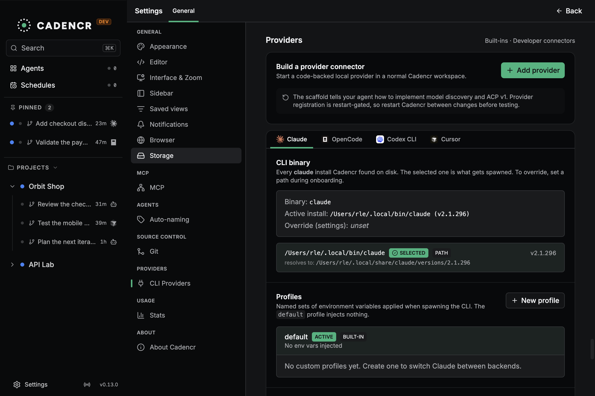

# Cadencr Provider Capability Coverage Ledger

> - **Status:** Current built-in coverage and regression reference
> - **Last reviewed:** 2026-10-13 against `v0.13.0` (source/release review; prior live evidence retained)
> - **Public provider contract:** ACP v1, as defined by [`BOUNDARIES.md`](./BOUNDARIES.md)

This document records which user-visible capabilities each built-in provider
currently delivers. It is **not** a marketplace admission checklist and it does
not require an ACP provider to implement every feature below. A third-party
provider is admitted through the minimum ACP v1 contract in `BOUNDARIES.md`.
The current `GenericAcpAdapter` covers local descriptor identity, mandatory
pre-session model discovery, selected-model reconciliation, negotiated ACP
configuration, and the baseline ACP v1 session path. The Pi column below records
live validation of the independent `cadencr-plugin-provider-pi` connector, which
maps native `pi --mode rpc` directly to ACP without `pi-acp`; it is evidence for
the generic host path, not a first-party support or marketplace-admission
promise.

Claude Code and Codex remain the rich parity references. Their native protocols
may expose more detail than ACP v1, but that detail must be translated inside the
owning adapter rather than becoming a Cadencr-specific provider requirement.
Cursor and OpenCode coverage is intentionally honest: partial or missing rows do
not make the provider invalid.

## How to read this ledger

- ✅ **Implemented:** the companion provider document describes a working path.
- 🟡 **Partial:** useful behavior exists, with a documented limitation.
- ❌ **Missing:** unsupported or affected by a known regression.
- **ACP baseline:** part of the minimum live session path Cadencr requires from an
  installed ACP v1 agent.
- **ACP optional:** advertised through ACP configuration, capabilities, or
  standard events and rendered only when present.
- **Built-in extension:** useful first-party behavior with no stable ACP v1
  equivalent; it remains optional and adapter-owned.

The normative language in the detailed sections applies **only after a provider
advertises or emits that capability**. It defines Cadencr's lossless projection
and safety behavior; it does not turn an optional capability into a marketplace
installation gate. Shared backend and frontend code must consume provider-neutral
types and must not branch on provider identity.

## Coverage matrix

| #   | Feature                                  | Contract class               | Claude Code | Codex | Cursor | OpenCode | Pi external ACP |
| --- | ---------------------------------------- | ---------------------------- | ----------- | ----- | ------ | -------- | ---------------- |
| 1   | Session modes                            | ACP optional capability      | ✅          | ✅    | ✅     | ✅       | ❌               |
| 2   | Thinking                                 | ACP optional capability      | ✅          | ✅    | ✅     | ✅       | ✅               |
| 3   | Partial / streaming messages             | ACP baseline                 | ✅          | ✅    | ✅     | ✅       | ✅               |
| 4   | Bash tool calls + outputs                | ACP optional capability      | ✅          | ✅    | ✅     | ✅       | ✅               |
| 5   | Edits / Writes / Patch                   | ACP optional capability      | ✅          | ✅    | ✅     | ✅       | ✅               |
| 6   | Sub-agents                               | Contained built-in extension | ✅          | ✅    | 🟡     | ✅       | ❌               |
| 7   | Todo                                     | ACP optional capability      | ✅          | ✅    | ✅     | ✅       | ❌               |
| 8   | Thinking level changes                   | ACP optional capability      | ✅          | ✅    | 🟡     | ✅       | ✅               |
| 9   | Model selection changes                  | ACP optional capability      | ✅          | ✅    | ✅     | ✅       | ✅               |
| 10  | Permissions: yes / no / always / session | ACP optional capability      | ✅          | ✅    | ✅     | ✅       | 🟡               |
| 11  | MCP                                      | ACP optional capability      | ✅          | ✅    | 🟡     | 🟡       | ❌               |
| 12  | Plan approval                            | Contained built-in extension | ✅          | ✅    | ✅     | ❌       | ❌               |
| 13  | Context usage                            | ACP optional capability      | ✅          | ✅    | ❌     | ✅       | ✅               |
| 14  | Compaction                               | Contained built-in extension | ✅          | ✅    | ✅     | ✅       | 🟡               |
| 15  | Command + skill list                     | ACP optional capability      | ✅          | ✅    | 🟡     | ✅       | ✅               |
| 16  | Live follow-up prompt targeting          | ACP baseline                 | ✅          | ✅    | ✅     | ✅       | ✅               |
| 17  | Durable session restore                  | ACP optional capability      | ✅          | ✅    | ✅     | ✅       | ✅               |

OpenCode restoration requires the live CLI to advertise `session/resume` or
legacy `loadSession`. Configured MCP servers are injected through ACP; observed
CLI statuses are merged with configured servers, which can remain `unknown`.

Point-in-time branching is implemented by Claude Code, Codex, and OpenCode.
Cursor and generic local ACP connectors have no such adapter capability. Codex
refuses a cut inside a native turn containing several user messages. See
[Rewind & Fork](../REWIND_AND_FORK.md).

Detailed evidence and limitations remain in
[`CLAUDE_CODE.md`](./CLAUDE_CODE.md), [`CODEX.md`](./CODEX.md),
[`CURSOR.md`](./CURSOR.md), and [`OPENCODE.md`](./OPENCODE.md).

### Pi external ACP validation notes

The Pi column is implemented by the separately versioned
`cadencr-plugin-provider-pi` connector using native `pi --mode rpc`; it does not
use `pi-acp` and no Pi-specific implementation is compiled into Cadencr:

- seven Pi models were discovered before session creation, and the user had to
  select a model before the first prompt;
- model-specific thinking levels, including `max` where supported, were
  negotiated and could be changed between turns;
- text and thinking stream separately; Pi's real tool lifecycle, image input,
  cancellation, and serialized live follow-up map into standard ACP updates;
- Pi slash commands become available after the ACP session handshake. Session
  statistics, naming, export, steering, follow-up mode, and auto-compaction were
  exercised. A small-session compaction correctly reported that there was
  nothing to compact; a successful large-context compaction was not forced;
- Pi RPC does not expose session modes, sub-agents, structured todos, plan
  events, or dynamic MCP registration. A bundled Pi extension bridges
  mutating/custom-tool confirmation to ACP permissions; "always allow" is not
  yet cached as a durable connector policy;
- `get_session_stats` drives context and cost updates. Durable sessions keep
  Pi's native session ID and load through a newly spawned
  `pi --mode rpc --session <id>` process. Automated fake-RPC and real-Pi QA
  restart both connector and Pi processes before asking the second turn to
  recall prior context.

---

## Detailed projection contracts

[Capability projection](./CAPABILITY_PROJECTION.md) preserves the detailed
mode, stream, tool, permission, MCP, usage, command, and durable-restore rules.

## Adding a provider

### Marketplace or local ACP provider

An ACP-speaking provider does **not** add Rust, TypeScript, or a provider SDK to
Cadencr. It ships independently versioned executable mapping code implementing
`models --format acp-config-options-v1` and `run --protocol acp-v1`, plus a
validated ACP Registry entry and host installation data. The existing
`GenericAcpAdapter` launches it as an external process. Admission depends on the
minimum ACP v1 contract and host policy in `BOUNDARIES.md`, not on implementing
every row in this ledger.

Capability data belongs to ACP `initialize`, session setup, and later standard
updates; it must not be copied into the marketplace descriptor as a second source
of truth. The generic adapter projects advertised model/mode catalogs and supported
select/boolean session configuration. Richer option types remain optional and
are not inferred from descriptors. Provider
account authentication is not such a control: the user preconfigures the native
CLI, and Cadencr neither stores credentials nor brokers ACP authentication for
marketplace connectors. The remaining provider-neutral bridge is tracked in
`BOUNDARIES.md`.

Local create/import flows are available with restart-gated activation. Public
marketplace browsing, installation, and publication remain inactive in v0.13.0;
backend package support does not imply a shipped public marketplace.

### First-party built-in integration

A built-in may still need a dedicated service adapter and transport SDK when its
native protocol preserves behavior ACP v1 cannot represent. In that case it must:

1. keep provider-specific decisions and native-to-neutral translation inside
   `packages/service/src/domain/agents/<provider>/`;
2. keep its SDK transport-only;
3. register its factory once in `providers/registry.rs::BUILTIN_PROVIDERS`;
4. add or update a companion coverage document and executable parity fixtures;
5. add no provider-ID branch to shared service or desktop code.
