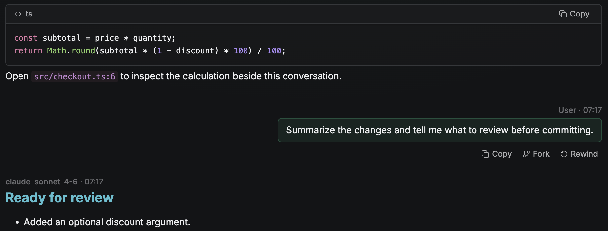

# Rewind & Fork — current implementation

> Reviewed against v0.13.0 source on 2026-10-13.
> User workflow: [Rewind & Fork guide](../packages/landing/src/pages/docs/rewind-and-fork.mdx).

## Behavior

Both operations cut context **before** a selected persisted user prompt and return
that prompt's text as an unsent draft. They interrupt/close any live turn before
branching. They do not submit a replacement prompt automatically.

| Operation | Conversation | Code | Destination |
| --- | --- | --- | --- |
| Rewind | Replace the current history with the prefix before the selected prompt | Restore the pre-turn checkpoint when present | Same feature/session |
| Fork | Copy the prefix into a new feature/session | Keep current code | Same project and shared working directory |

A fork copies worktree bindings and creates no new checkout. Source and fork see
and edit the same files. Independent implementation requires separate worktrees.

## Provider implementations

The provider-neutral `SessionBranching::truncate_before` contract lives in
`agents/adapter/branching.rs`. Registration is through each adapter's
`session_branching()` capability. Shared orchestration does not branch on IDs.

| Provider | Context cut | Important limit |
| --- | --- | --- |
| Claude Code | New transcript containing the prefix before the real user-prompt ordinal | Tool results/meta/compact summaries are excluded from prompt counting |
| Codex | Profile-resolved app server reads/forks the thread and rolls back whole native turns | Refuses a cut inside a turn with several user messages |
| OpenCode | Adapter-owned headless ACP/HTTP fork before a provider message ID, with ordinal fallback | Requires available native session/message history |
| Cursor / generic local ACP | No registered point-in-time branching implementation | Do not infer support from ordinary resume or a similarly named CLI command |

A cut before the first prompt keeps no previous context and starts fresh. If no
provider runtime ID was ever produced, there is likewise no provider history to
retain. For a nonempty native history, unsupported or failed branching aborts;
there is no successful-looking fallback that resumes the full uncut context.

## Checkpoints and restore ordering

The provider-neutral checkpoint subsystem captures pre-turn code snapshots.
Checkpoint refs and DB message associations are separate from provider history.
Tracked/staged state is covered by the checkpoint implementation; ordinary
untracked files are preserved. Files outside the working tree are not backed up.

`session_branch/rewind.rs` performs the following steps:

1. Validate the selected session/user message and resolve its working directory.
2. Read checkpoint state; a DB failure is an error, not an absent checkpoint.
3. If restoring a checkpoint into a dirty tree, request explicit discard
   confirmation. An unreadable Git status also requires confirmation.
4. Interrupt/close the live turn.
5. Truncate provider context first; abort on an unsupported/failed native cut.
6. Restore code before mutating conversation rows; a required restore failure
   returns `CODE_RESTORE_FAILED`.
7. Apply the conversation/runtime-ID cut and restore the draft. Broadcast the
   confirmed result and idle status.

Without a checkpoint, the operation can rewind conversation context without
restoring code; the result reports whether code was restored. The interface must
not describe a missing snapshot as a successful code restore.

Fork uses the same validation/interruption/context cut, then creates the new
feature and history prefix transactionally. It emits `FeatureEventAction::Created`
and `BranchForked`; the originating client navigates to the new feature.

## Source and validation anchors

| Area | Current source |
| --- | --- |
| Shared validation/context branching | `packages/service/src/domain/ws_session/handler/session_branch/mod.rs` |
| Rewind sequencing | `session_branch/{rewind,rewind_state}.rs` |
| Fork and persistence | `session_branch/{fork,fork_db}.rs` |
| Code snapshots | `packages/service/src/domain/checkpoints/` |
| Native context cuts | `packages/service/src/domain/agents/{claude_code,codex,opencode}/branching.rs` |

Tests include native cut/ordinal handling, rejection of Codex multi-prompt cuts,
fork prefix/worktree preservation, and checkpoint/rewind persistence. The current
documentation review exercised visible actions with example data; it did not
perform destructive rewinds on real user conversations.

## Historical plan

The original Claude-first plan is retained for design history. Its Claude-only
status, future-provider backlog, fallback proposals, and line-number anchors are
superseded by the implementation above.

- [Architecture and initial decisions](./rewind-and-fork/history/architecture.md)
- [Backend design and sequence diagrams](./rewind-and-fork/history/runtime.md)
- [Delivery, edge cases, and original test plan](./rewind-and-fork/history/delivery.md)
