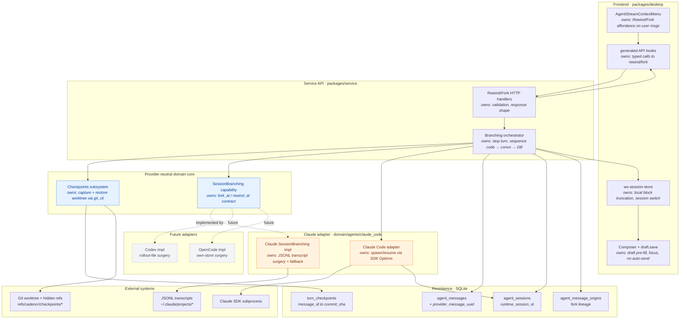

# Historical Claude-first branching plan: architecture

> Archived during the v0.13.0 review on 2026-10-13. This preserves the original
> implementation plan, including superseded decisions and proposed fixes.
> Use [the current reference](../../REWIND_AND_FORK.md) for shipped behavior.

# Rewind & Fork — Implementation Plan

> Status: **Implemented for Claude Code** (Phases 1–6). Codex/OpenCode pending
> (the seam is ready — see §12).
> Audience: an engineer/agent implementing the feature end-to-end.
> Scope of this document: **Claude Code provider first**, but every abstraction is
> designed so Codex and OpenCode can implement the same feature later without
> touching provider-neutral code.

## Implementation notes (what shipped vs. the plan)

- **Context cut = ordinal, not uuid, for Claude.** Claude assigns a JSONL `uuid`
  to a user prompt only when it writes the transcript line; the headless stream
  does not reliably echo the prompt back, and resume-replays would mis-stamp. So
  the `provider_message_uuid` column ships (nullable, future-proof) but the
  Claude cut is resolved by **ordinal** — the Nth real user-prompt line (tool
  results / meta / compact-summary lines excluded). The `SessionBranching`
  contract still *prefers* `cut_provider_uuid` when a provider populates it, so
  uuid-match is live for future adapters. Matches §10's documented fallback,
  here promoted to the Claude primary.
- **Per-turn checkpoint capture** is wired into BOTH the pending (first prompt)
  and followup (steering / subsequent turns) paths, because Claude keeps the CLI
  alive between turns and most prompts after the first take the followup path.
  Capture runs synchronously before the prompt reaches the agent (so the snapshot
  is genuinely pre-edit) but holds no session lock.
- **Fork creates a new *feature* that shares the source worktree** (open question
  #1 resolved this way instead of deferring). The feature view binds exactly one
  session and there is no multi-session switcher, so rather than spawn a second
  session inside the source feature, fork mints a **new feature** (first-class
  sidebar entry + view) under the same project. It copies the source feature's
  `worktree_*` settings verbatim, so the new feature resolves to the **identical
  worktree directory** with **zero git ops** — the provisioning replay
  short-circuits on the already-present path (a `git worktree add` on the
  already-checked-out branch would otherwise fail). The chosen message's text is
  written to the new feature's `feature_settings.draft_prompt` (the source the
  composer actually restores from — the session-scoped `agent_sessions.draft_prompt`
  is **not** what the composer reads). The backend emits `FeatureEventAction::Created`
  so the fork appears in every client's sidebar, and the originating client
  **auto-navigates** to it (a session-scoped `forkNavigation` store signal consumed
  by the source `AgentSession`). Both features then edit the same files — the
  accepted trade-off of sharing one worktree. Rewind (in place) is fully wired too.
- **Checkpoint GC** (open question #3) is not implemented in v1 — `refs/cadencr/
  checkpoints/*` and `turn_checkpoints` rows accumulate until the feature is
  deleted (CASCADE clears the rows). Pick a retention policy in a follow-up.

---

## 1. What we are building

Two per-user-message actions, surfaced from the agent stream:

- **Rewind to here** — roll the conversation **and** the code back to the state
  *before* a chosen user message, **in place** (same session). The chosen
  message's text is restored into the composer as a **draft and is NOT sent** —
  the user can edit and re-send.
- **Fork from here** — create a **new feature** (with its own session) that keeps
  only the context *before* the chosen user message, **sharing the source
  feature's worktree** (no new worktree, no code rollback). The originating client
  navigates to the new feature; the chosen message's text is restored into its
  composer as a **draft and is NOT sent**.

Both actions require **point-in-time truncation of the model's real context**
(not just our UI). See §3 for why and how.

### Non-goals (v1)

- Forking into a separate *worktree* (the fork is a new feature but **shares**
  the source worktree on purpose — see §3). A future "fork into an isolated
  worktree" mode is possible (branch from the fork-point checkpoint) but out of
  v1 scope.
- Rolling back files changed by bash commands or files outside the worktree
  (same limitation as Claude's native `/rewind`).
- Codex / OpenCode implementations (architecture is ready for them — see §12).

---

## 2. Why we can't use Claude's native `/rewind` or `/fork`

Researched against Claude Code 2.1.x docs:

- **`/rewind`** is an **interactive TUI menu** (open with `/rewind` or double
  `Esc`). There is **no headless flag, no `stream-json` command, and no Agent
  SDK method** to trigger a point-in-time restore. Cadencr drives Claude with
  `--print --output-format stream-json --input-format stream-json`, which has no
  terminal UI for that menu to render into. Native checkpoints are Claude's
  internal snapshot store tied to a live interactive process — our subprocess
  can neither trigger nor query them.
- **`/fork`** (alias of `/branch`) has a headless equivalent — the
  **`--fork-session`** flag — but it (a) copies the **entire** transcript (no
  point-in-time cut), and (b) only takes effect on a **live run that sends a
  prompt**, whereas our fork must branch **without sending**. Considered and
  rejected as the primary mechanism for those two reasons.

**Conclusion:** we re-implement the behavior over the headless transport with
**(a) our own git checkpoints for code** and **(b) Claude transcript surgery for
conversation context**.

References: `code.claude.com/docs/en/checkpointing`, `/en/sessions`,
`/en/headless`.

---

## 3. Locked decisions

| Decision | Choice | Rationale |
|---|---|---|
| Context-truncation fidelity | **Faithful transcript surgery** | The model must genuinely forget everything after the cut; matches native `/rewind` and the "keep context before N" spec. Non-truncating resume (t3code-style) and DB-replay were rejected as not meeting the spec. |
| Fork target | **New feature, sharing the source worktree, new Claude session id** | A new feature is a first-class view + sidebar entry, so the fork has somewhere to render and the client can navigate to it (no multi-session switcher needed). It copies the source's `worktree_*` settings, resolving to the *same* directory with no git ops. |
| Fork + code | **Fork does NOT roll back code** | The forked feature shares the source worktree; restoring code under it would clobber the originating feature. Fork branches **conversation only**; code stays at the worktree's current state. Coherent code+conversation rollback is the **rewind** flow's job. |
| Provider isolation | **Adapter/capability trait** | Claude-specific surgery lives behind a trait; generic code never branches on provider identity (project rule). |
| Surgery failure | **Auto-fallback to non-truncating resume + user-visible warning** | Never hard-fail the user action if the internal JSONL format drifts. |

---

## 4. Current architecture (verified anchors)

Real files this plan builds on:

- **Adapter capability trait:** `AgentRuntimeAdapter`
  (`packages/service/src/domain/agents/adapter/adapter_trait.rs:13`) — default-
  method trait, the seam for a new branching capability.
- **Live session trait:** `AgentRuntimeSession`
  (`packages/service/src/domain/agents/adapter/session.rs:27`) — exposes
  `interrupt()` (`:51`), `stream_input()` (steering, `:42`), `session_id()`
  (`:35`), `close()` (`:57`).
- **Turn lifecycle state:** `QueryState { Active { query, .. }, Pending(config) }`
  (`packages/service/src/domain/ws_session/handler/types.rs:20`), held per
  connection in `SdkSessions` keyed by db session id.
- **Send / steering entry:** `handle_prompt_send`
  (`.../session_prompt/prompt_send.rs:21`) — three paths: **followup** (we own
  the live turn → `stream_input`), **owner steering**, **pending spawn**.
- **Cancel entry:** dispatch `"interrupt"`
  (`.../handler/dispatch.rs:95`) → `handle_interrupt`
  (`.../handler/session_control/lifecycle.rs:14`) → `q.interrupt()`.
- **Claude spawn/resume:** `claude_code/adapter_impl.rs:250` builds
  `Options { resume: config.resume_session_id, .. }`; resume id validated as
  UUID (`adapter_impl.rs:23`).
- **Claude session id capture:** from `system/init`
  (`claude-agent-sdk-rs/src/messages/events.rs:79`), persisted via
  `persist_runtime_session_id_*`
  (`.../persistence/session_archiving.rs:54`).
- **JSONL transcript path helpers:** `encode_project_path`,
  `claude_projects_dir_for`, `parse_session_file`
  (`domain/imports/claude_code_jsonl.rs`). **Reuse these — do not reinvent.**
- **Message store:** `agent_messages` (`migrations/0001_baseline.sql:120`),
  ordered by autoincrement `id`; user msg = `role='user' AND
  message_type='user_message'`. Model `AgentMessageRow`
  (`domain/sessions/models.rs:30`).
- **Lineage table (reuse for fork):** `agent_message_origins`
  (`migrations/20260618120000_mcp_orchestration_schema.sql`), `origin_kind IN
  ('human','session_generated','system_generated','imported')`.
- **Worktree:** per-feature at `~/.cadencr/worktrees/{project}/{branch}`;
  path/branch in `feature_settings`; git plumbing in `shared/git_cli.rs`
  (`run_git`, `run_git_safe`, `run_git_capture`) and
  `domain/git/commands/worktree_ops.rs`. **No per-turn checkpoint exists today —
  this is the main net-new substrate.**
- **Composer draft persistence already exists:** WS routes `"draft.save"` /
  `"draft.get"` (`dispatch.rs:112-113`,
  `handler/session_data.rs`). **Reuse this to pre-fill the draft** instead of
  inventing a new channel.
- **Frontend per-message menu:** `AgentStreamContextMenu`
  (`packages/desktop/src/components/agent-session/AgentStreamContextMenu.tsx`)
  already wraps every block — natural home for the affordance.
- **User bubble + provenance badge:** `UserMessageBlock.tsx` already renders an
  origin badge from `agent_message_origins`.
- **Session store:** `ws-session-store.ts` (blocks, `sendPrompt`, `sendRaw`),
  envelopes in `lib/ws-envelope.ts` (`createPromptSend`, `createInterrupt`).

---

## 5. Architecture of responsibilities



**Invariant:** the only provider-aware nodes are inside the orange `CLAUDE` box,
reached exclusively through the `SessionBranching` capability. The orchestrator,
checkpoints subsystem, HTTP layer, DB, and frontend are all provider-neutral.

---

## 6. Data model

New migration (follow the `migration-safety` skill — additive, no destructive
rebuilds):

```sql
-- turn_checkpoints: links a user message to the worktree snapshot taken
-- immediately BEFORE that turn ran (i.e. the "before message N" code state).
CREATE TABLE turn_checkpoints (
    message_id  INTEGER PRIMARY KEY REFERENCES agent_messages(id) ON DELETE CASCADE,
    commit_sha  TEXT NOT NULL,        -- orphan commit under refs/cadencr/checkpoints/*
    kind        TEXT NOT NULL DEFAULT 'pre_turn',  -- pre_turn | post_turn (future)
    created_at  TEXT NOT NULL DEFAULT (datetime('now'))
);

-- map a Cadencr message row to the provider's own message id, so transcript
-- surgery can find the exact cut line. Provider-neutral column name.
ALTER TABLE agent_messages ADD COLUMN provider_message_uuid TEXT;
CREATE INDEX idx_agent_messages_provider_uuid
    ON agent_messages(session_id, provider_message_uuid);
```

Notes:

- `turn_checkpoints` is a **side table** so the hot `agent_messages` path is
  untouched.
- `provider_message_uuid` is **provider-neutral by name** (Claude stores its
  per-message `uuid`; Codex/OpenCode store their own id).
- Fork lineage reuses **`agent_message_origins`** — no new table.

---
