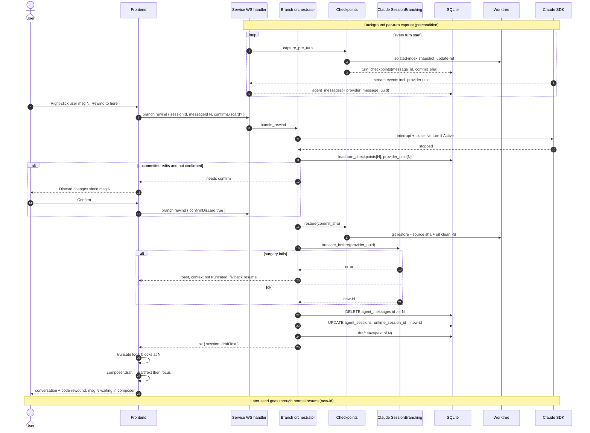
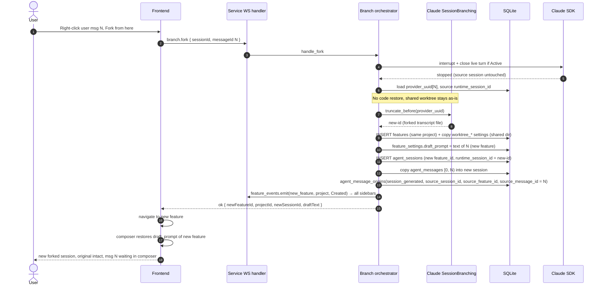

# Historical Claude-first branching plan: runtime

> Archived during the v0.13.0 review on 2026-10-13. This preserves the original
> implementation plan, including superseded decisions and proposed fixes.
> Use [the current reference](../../REWIND_AND_FORK.md) for shipped behavior.

## 7. Backend design

### 7.1 Capability seam (adapter pattern, future-proof)

Add an **optional capability** to `AgentRuntimeAdapter` — default `None`, so
providers that don't support branching are simply inert (no provider branching
in generic code):

```rust
// adapter/branching.rs  (new)
#[async_trait]
pub trait SessionBranching: Send + Sync {
    /// Produce a NEW provider session id whose context ends immediately before
    /// `cut_provider_uuid`. Used by both rewind (in place) and fork (new session).
    /// `source_runtime_session_id` is the provider session being branched from.
    async fn truncate_before(
        &self,
        ctx: &BranchContext,            // cwd, source_runtime_session_id, cut_provider_uuid
    ) -> Result<BranchResult, BranchError>;  // { new_runtime_session_id }
}

// adapter_trait.rs — new default method on AgentRuntimeAdapter
fn session_branching(&self) -> Option<&dyn SessionBranching> { None }
```

The orchestrator calls `adapter.session_branching()`; if `None`, the action is
reported unsupported for that provider (graceful, surfaced to UI). Rewind vs fork
is an **orchestration concern**, not a provider concern — both use the same
`truncate_before`. This keeps the provider surface minimal and identical across
Claude/Codex/OpenCode.

### 7.2 Claude `SessionBranching` impl — transcript surgery

Location: `domain/agents/claude_code/branching.rs`.

Algorithm for `truncate_before`:

1. Resolve transcript path with the existing import helpers:
   `claude_projects_dir_for(cwd).join(format!("{source_id}.jsonl"))`.
2. Read the JSONL **leniently** — parse each line as `serde_json::Value`; only
   read the fields we need (`uuid`, `sessionId`). Never deserialize into a strict
   struct (format is version-unstable per Anthropic docs).
3. Find the cut index = first line whose `uuid == cut_provider_uuid`. Keep lines
   `[0, cut)`. (Fallback if uuid missing: ordinal match on the Nth
   `type == "user"` line — see §10.)
4. Generate `new_id = uuid v4`. Rewrite the `sessionId` field on every kept line
   to `new_id` (keeps the resume chain self-consistent). Leave `uuid` /
   `parentUuid` chains intact — a truncated prefix is a valid leaf.
5. Write `claude_projects_dir_for(cwd).join(format!("{new_id}.jsonl"))`
   atomically (temp file + rename).
6. Return `BranchResult { new_runtime_session_id: new_id }`.

Later resume uses the **existing** `Options { resume: Some(new_id) }` path — no
new spawn code.

On any failure (parse error, missing file, uuid not found and ordinal fallback
also fails): return `BranchError::Unsupported`/`::Surgery` so the orchestrator
falls back to **non-truncating resume of the source session** and emits a
user-visible warning toast (`.claude/rules/error-handling`: never swallow).

Keep this file < 400 lines (`.claude/rules/file-size`); split a
`jsonl_surgery.rs` helper if needed.

### 7.3 Checkpoints subsystem (provider-neutral)

Location: `domain/checkpoints/` (new module). Pure git, no provider knowledge.

**Capture** (`capture_pre_turn`): on each turn start, before the agent edits,
snapshot the worktree using an **isolated index** so the user's real index is
never touched:

```
GIT_INDEX_FILE=<tmp> git -C <worktree> read-tree HEAD
GIT_INDEX_FILE=<tmp> git -C <worktree> add -A -- .
tree=$(GIT_INDEX_FILE=<tmp> git -C <worktree> write-tree)
commit=$(git -C <worktree> commit-tree $tree -m "cadencr checkpoint <feature>/<seq>")
git -C <worktree> update-ref refs/cadencr/checkpoints/<feature>/<seq> $commit
```

Persist `turn_checkpoints(message_id = <the user message that starts this turn>,
commit_sha = $commit, kind='pre_turn')`. Implement via `shared/git_cli.rs`
runners (add an env-injecting variant if one doesn't exist). `git add -A`
respects `.gitignore`, so build artifacts/secrets are not snapshotted.

**Restore** (`restore`): used by rewind only.

```
git -C <worktree> restore --source <sha> --worktree --staged -- .
git -C <worktree> clean -fd -- .      # NOT -x: preserve ignored files
```

**Hook point:** turn start is observed where the spawn/first stream event is
handled — wire capture in the stream/persistence path
(`domain/ws_session/persistence/session_events.rs` or the stream reader). Capture
must be **best-effort and non-blocking to the turn**: if git capture fails, log +
toast but let the turn proceed (a missing checkpoint disables *code* rewind for
that message, not the conversation rewind).

### 7.4 Orchestrator — flows

Location: `domain/ws_session/handler/session_branch/` (new), provider-neutral.

Shared preamble for **both** flows:

1. Resolve db session, target `message_id`, and verify `role='user' AND
   message_type='user_message'`.
2. **Stop the live turn if any** (see §8). For rewind we *must* interrupt+close
   the current Active query before mutating; for fork we must at least read a
   consistent `runtime_session_id`.
3. Load `turn_checkpoints[message_id]` (may be absent → code rewind unavailable)
   and `agent_messages[message_id].provider_message_uuid`.

**Rewind (in place):**

1. (code) If a checkpoint exists: `checkpoints::restore(commit_sha)`. If the
   worktree has uncommitted user edits, require a confirm flag in the request
   (UI shows a dialog first) — refuse without it.
2. (context) `branching.truncate_before(...)` → `new_id` (or fallback).
3. (db) `DELETE FROM agent_messages WHERE session_id=? AND id >= message_id`
   (CASCADE removes their `turn_checkpoints`). `UPDATE agent_sessions SET
   runtime_session_id = new_id`.
4. (draft) Persist the removed message's text as the session draft (reuse the
   `draft.save` mechanism).
5. Respond `{ session, draft_text }`. Streaming resumes through the normal send
   path when the user re-sends.

**Fork (new feature, shared worktree, new session):**

1. **No code restore** (decision §3).
2. (context) `branching.truncate_before(...)` → `new_id`.
3. (db, one tx) Create a **new feature** under the source's `project_id`; copy the
   source feature's `worktree_*`/`skip_worktree` settings so it resolves to the
   same directory; write the chosen message's text to the new feature's
   `feature_settings.draft_prompt`; create an `agent_sessions` row under the **new**
   feature, copy `agent_messages[0, message_id)` into it, set `runtime_session_id =
   new_id`. Record lineage: `agent_message_origins(origin_kind='session_generated',
   source_session_id, source_feature_id, source_message_id=message_id)`.
4. (broadcast) `feature_events.emit(new_feature_id, Some(project_id), Created)` so
   every client's sidebar shows the fork.
5. Respond `{ newFeatureId, projectId, newSessionId, draftText }`. The originating
   client navigates to the new feature; its composer restores the draft.

### 7.5 Transport — routes

These are stateful session operations that interact with live `SdkSessions`, so
follow the existing **WS dispatch** pattern rather than bare HTTP (mirrors
`interrupt`, `compact`, `clear`). Add to `dispatch.rs`:

```
"branch.rewind" => session_branch::handle_rewind(...)
"branch.fork"   => session_branch::handle_fork(...)
```

Frontend envelopes in `lib/ws-envelope.ts`: `createRewind(sessionId, messageId,
{ confirmDiscard })`, `createFork(sessionId, messageId)`. (If a typed HTTP
response is preferred for the new-session payload on fork, expose a thin
`POST .../fork` and regenerate the API client per the repo workflow — but the WS
route is the lower-friction default.)

---

## 8. Turn steering & cancelling (must-handle interplay)

The feature must compose correctly with the existing live-turn machinery.

- **Steering (message added during a turn)** — `handle_prompt_send`'s followup
  path streams into the live `Active` query (`stream_input`). **Rule:** rewind /
  fork **target a persisted user message**, which means the turn that produced
  the messages after it has already completed for those rows. If a turn is
  *currently live* when the user triggers rewind/fork, the orchestrator first
  **interrupts and closes** that live turn (reuse `q.interrupt()` then drop the
  `Active` state to `Pending`), exactly as `handle_interrupt` does
  (`session_control/lifecycle.rs:14`, `session_gate.rs:171`). Steering deltas
  that arrived but were not yet persisted are discarded by the truncation +
  `runtime_session_id` swap.
- **Cancelling (stop during a turn)** — reuse the existing interrupt path; do not
  invent a second cancel. The orchestrator's "stop live turn" preamble calls the
  same `interrupt()` the Stop button uses. After interrupt, the partial assistant
  output already persisted up to `message_id` is preserved; everything `>=
  message_id` is deleted by rewind (or simply not copied by fork).
- **Receipts / pending-spawn** — if the session is in `Pending` (no live turn),
  skip the interrupt step. If a prompt receipt is in flight (optimistic user
  block not yet acknowledged), the orchestrator must operate on **persisted**
  rows only and let the frontend reconcile its optimistic block on the response.

**Ordering guarantee:** stop-turn → (rewind: restore code) → truncate context →
mutate db → save draft → respond. The live `SdkSessions` lock is held only for
the stop-turn transition, not for the git/file work (avoid blocking other
sessions — `.claude/rules/frontend-performance` spirit applies to the backend
event loop too).

---

## 9. Sequence diagrams

### 9.1 Rewind



### 9.2 Fork



---
